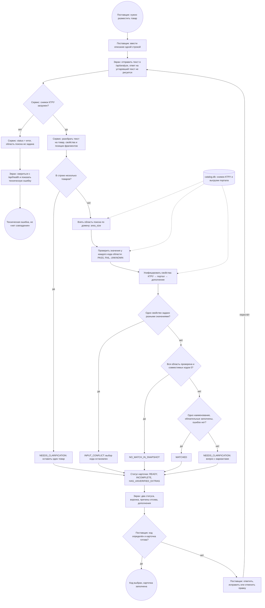

# BPMN: заполнение характеристик СТЕ и подбор кода КТРУ

Схема лежит в [process.bpmn](process.bpmn). Её открывают в [demo.bpmn.io](https://demo.bpmn.io) (Open → файл) или в Camunda Modeler. Ниже та же схема в Mermaid (GitHub рисует её прямо на странице) и таблица: какой элемент схемы каким местом кода выполняется.

## Три развилки, о которые чаще всего спотыкаются

1. **Конфликт останавливает выбор.** Если одно свойство задано двумя разными значениями («высота 750 мм высота 900 мм»), ядро ставит `match_status = INPUT_CONFLICT` и не выдаёт код: `best_ktru = null`, кандидатов нет. Экран не показывает ни код, ни уточняющий вопрос. Вместо них он предлагает кнопки «Оставить 750 мм» и «Оставить 900 мм». Проверка идёт раньше двух других исходов подбора, поэтому противоречивый ввод никогда не превращается в «нет совпадения» или «код определён».
2. **«Нет совпадения» ставится только после полной проверки области.** `NO_MATCH_IN_SNAPSHOT` выставляется, когда проверена вся область домена (`search.completeness = full`) и совместимых кодов не осталось (`compatible_count = 0`). Если по тексту ничего не нашлось, но область не проверена полностью (например, «абракадабра»), ответ будет `NEEDS_CLARIFICATION`, а не «нет совпадения».
3. **Отказ базы — отдельная техническая ошибка.** Если `catalog.db` нет или она пустая, сервис не ищет: ответ приходит со `status = error`, без области поиска и без шагов сужения. Экран не считает такой ответ результатом поиска. Он спрашивает `/api/health`, и при `db_ready = false` показывает бейдж «Подбор: техническая ошибка» с текстом «про наличие кода КТРУ ничего не известно». Так же экран поступает при ответе 5xx и при недоступном сервере. Бейдж «нет совпадения в снимке КТРУ» в этих случаях не появляется.

## Соответствие схемы коду

| Элемент схемы | Где в коде |
|---|---|
| Отправить текст; ответ на устаревший текст не рисуется | `frontend/app.js`: `analyze()`. Номер запроса `state.seq` и сравнение отправленного снимка `{текст, категория, правки таблицы}` с текущим (`sameSnap`). Ответ рисуется, только если это последний запрос и текст с тех пор не менялся |
| Снимок КТРУ загружен? / Отказ базы | `app/engine.py`: `CatalogEngine.analyze`, ветка `self.catalog is None`; `app/db.py`: `db_ready()` |
| Свериться с /api/health и показать техническую ошибку | `frontend/app.js`: `looksLikeDbFailure()`, `health()`, `showTech()`; `app/main.py`: `GET /api/health` |
| Разобрать текст | `app/parser.py`: `parse_text`. Свойства с позициями `start/end` и признаком отрицания |
| В строке несколько товаров? | `app/engine.py`: ветка `parsed.ambiguities` → `NEEDS_CLARIFICATION`, поле `ambiguities` |
| Взять область поиска; проверить значения у каждого кода | `app/matcher.py`: `narrow_ktru` → `search.area_size`, `checked_count`, `compatible_count`, `checks` (PASS / FAIL / UNKNOWN с причиной) |
| Унифицировать свойства | `app/unify.py`: `unify_characteristics` → `origin`: `ktru`, `portal` или `new` |
| Одно свойство задано разными значениями? | `app/engine.py`: `_detect_input_conflict` → `INPUT_CONFLICT`, `best = None` |
| Вся область проверена и совместимых 0? | `app/engine.py`: `compatible_count == 0 and area_pass_done and completeness == "full"` |
| Одно наименование, обязательные заполнены, ошибок нет? | `app/engine.py`: `completeness == "full"`, одно наименование в группе, нет пустых обязательных, нет ошибок, отрыв лучшего кода не меньше `OK_MARGIN` |
| Вопрос с вариантами | `app/questions.py`: `choose_question` → поле `question` (до 6 вариантов) |
| Статус карточки | `app/engine.py`: `INCOMPLETE`, если не заполнены обязательные, ничего не распознано или есть ошибка; `HAS_UNVERIFIED_EXTRAS`, если есть заполненное свойство с `origin = new`; иначе `READY` |
| Показать два статуса, воронку, причины отсева, дополнения | `frontend/app.js`: `badgesBlock`, `countersBlock`, `funnelBlock` (причины из `checks`), `extrasBlock` (свойства с `origin = new` отдельно от строк КТРУ) |
| Ответить, исправить или отменить правку | `frontend/app.js`: `answer()` дописывает «поле: значение» в текст; `keepValue()` снимает конфликт; `applyFix()` исправляет опечатку в тексте; `editRow()` переносит правку таблицы в текст или в `characteristics`; `undo()` возвращает прошлый текст и пересчитывает ответ |

## Дорожки

| Дорожка | Кто | Что делает |
|---|---|---|
| Поставщик | ЮЛ, ИП, самозанятый | Пишет описание, отвечает на вопрос, исправляет значения |
| Экран | `frontend/` | Отправляет запрос, отбрасывает устаревшие ответы, показывает статусы и причины |
| Сервис | `app/` (FastAPI) | Разбор, проверка по области КТРУ, унификация, статусы |
| Данные | `data/processed/catalog.db` | Снимок КТРУ (3391 позиция в скоупе) и выгрузки портала |
