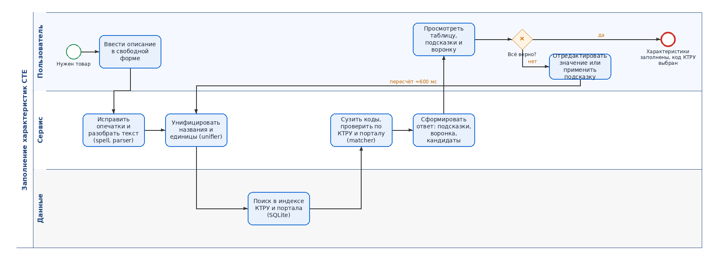
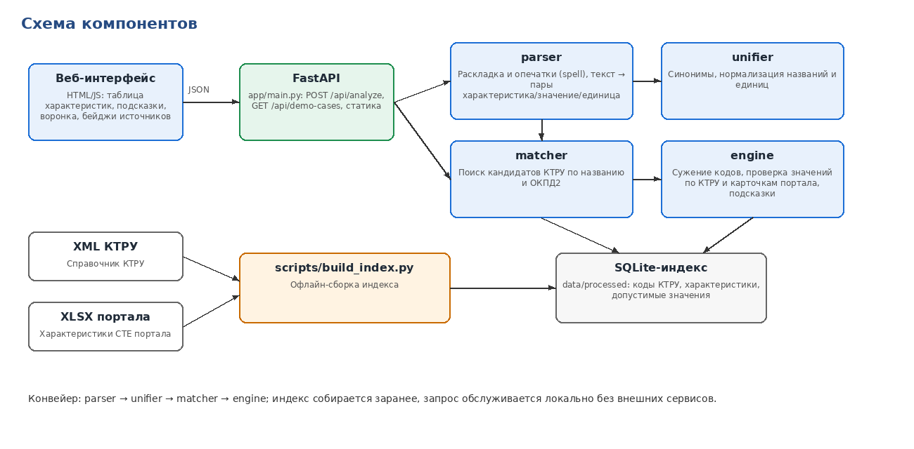

# Помощник заполнения характеристик СТЕ — Tender Hack 2026

Черновик презентации для предзащиты (до 5 минут, 7 слайдов).

---

## Слайд 1. Проблема

- Поставщик описывает товар свободным текстом, а для СТЕ нужны характеристики по КТРУ.
- Код КТРУ — это группа товаров, а не конкретный товар; подобрать правильную группу и заполнить её обязательные характеристики сложно.
- Ошибки: опечатки, неверные единицы, значения вне допустимого списка, пропущенные обязательные характеристики.
- Итог: карточки отклоняются, позиции дублируются, сравнивать цены тяжело.

## Слайд 2. Решение

- Пользователь вводит описание — сервис выделяет характеристики и сразу показывает их в редактируемой таблице.
- У каждой характеристики бейдж источника: **КТРУ**, **Портал** или **Новая**.
- Подсказки: что не так, что ожидается, варианты исправления в один клик; недостающие обязательные характеристики добавляются кнопкой.
- Воронка сужения: сколько кодов КТРУ осталось после каждого шага и почему.
- Любая правка пересчитывает результат автоматически (≈600 мс задержки ввода).

## Слайд 3. Процесс (BPMN)

- Дорожки: Пользователь / Сервис / Данные.
- Цикл «правка → пересчёт» повторяется, пока пользователь не подтвердит результат.
- Исходник: `docs/process.bpmn` (открывается в Camunda Modeler / bpmn.io).

## Слайд 4. Архитектура

- Веб-интерфейс (HTML/JS) → FastAPI → parser → unifier → matcher → engine.
- SQLite-индекс собирается заранее скриптом `scripts/build_index.py` из XML КТРУ и выгрузки XLSX портала.

## Слайд 5. Почему такие технологии

- **Python + FastAPI**: быстрая разработка, валидация контракта через Pydantic, автодокументация API.
- **SQLite**: один файл, без отдельного сервера, быстрый поиск по справочнику; легко развернуть в Docker.
- **Правила и словари вместо LLM в основе**: детерминированно, объяснимо (каждое сужение имеет причину), без внешних зависимостей и утечки данных.
- **Чистый HTML/JS**: нет сборки, легко встроить в существующий портал, стиль Портала поставщиков.

## Слайд 6. Результаты и демо

- Демо-сценарии: мебель, одежда, инструменты — от свободного текста до кода КТРУ.
- Показываем: таблицу с бейджами, подсказку с исправлением в один клик, воронку N → M → 1.
- Метрики QA на 45 кейсах (одежда, мебель, инструменты; чистые, неполные, с ошибками): верный код КТРУ на 1-м месте — 96%, в топ-3 — 100%; корректный статус — 98%; ложно-уверенных ответов на кейсах с ошибками — 0%; время ответа p50 48 мс, p95 99 мс (`debug.elapsed_ms`); чистая сборка индекса — 71 с.
- _Цифры на текущей версии (прогон QA 10.10.2026, 45 кейсов), будут обновлены._
- Важно: на одну СТЕ свои цены ставят многие поставщики, по ним рассчитывается референтная цена — поэтому корректные характеристики СТЕ критичны для сопоставимости цен.

## Слайд 7. Команда и роли

- Координация и интеграция — _ФИО_
- Ядро КТРУ (разбор, унификация, сужение кодов) — _ФИО_
- Интерфейс, документация и защита — _ФИО_
- Тестирование и качество — _ФИО_
